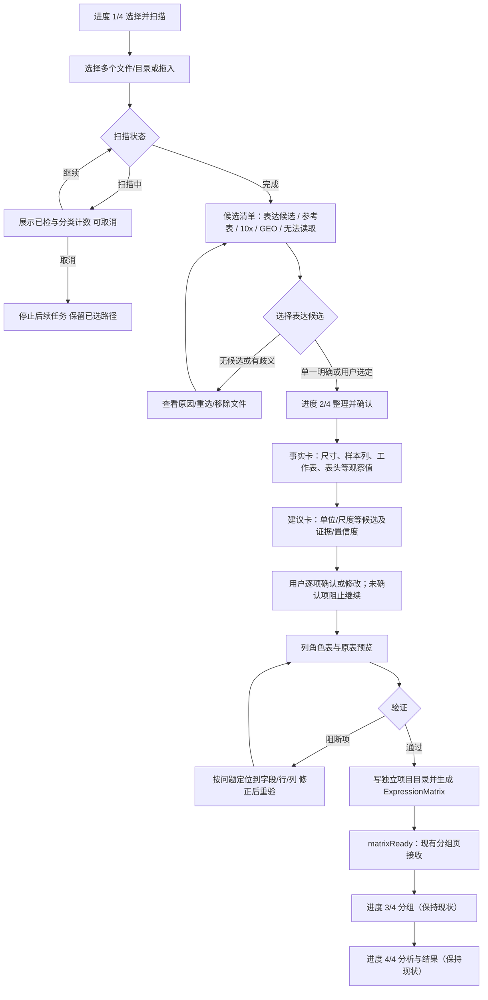
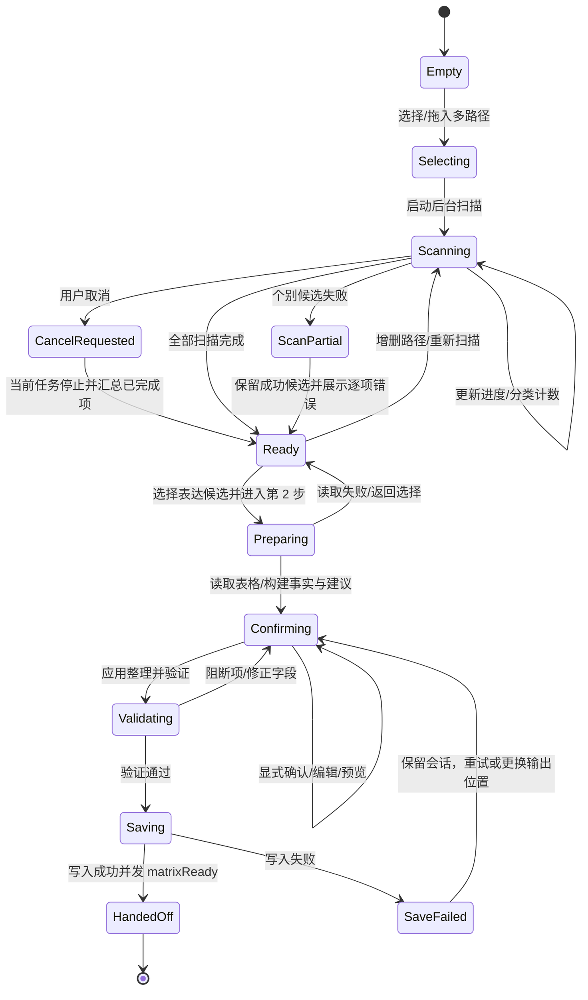

# 导入向导阶段设计（2026-09-23）

## 2026-09-23 实施检查点

首轮已把验证入口移出四步主导航，并对导入文件清单加入纵向滚动保护；整理向导显示按当前表头/方向/列角色估算的“特征 × 样本”结构，每个结构/列角色问题均有可展开的通俗原因。无证据时不从文件名或数值长相推断单位与变换；工作簿工作表名称仅形成可撤销候选。迭代 2 将普通表格和 GEO 的会话预览限制为最多 40×80；用户走到最终整理时才由后台补读全表。预览状态不再声称这是总特征数；完整样本轴若超过首轮可见范围，会阻断而不是静默丢列。扫描、读取和逐行完整校验均在 worker 中报告进度并支持协作取消；保存矩阵和 manifest 时隐藏取消入口，避免留下半成品。count/TPM 同工作簿建议优先查看 count；同优先级的多个 count sheet 要求明确选择。主窗口最低宽度保留为 820 px、最低高度调为 560 px；窄屏实测尚待补齐。

最新完整源码回归为 125 passed、1 skipped；真实只读的 GSE10361 Series Matrix（1.6 MB）此前识别为 22,284 × 10、GPL96，单位与变换保持未知。上轮源码窗口（通过 Python.app 可执行路径绑定）在 984×768 截图中未见首屏遮挡，工具菜单及主要键盘焦点已确认；该截图早于本次有限预览修改。新增离屏 GUI 端到端测试用 1,500 个特征，从 40 行预览、显式确认原始 count/linear、后台补读全表、校验/保存，到收到兼容 `ExpressionMatrix` 的 `matrixReady` 信号，均通过。临时混合交付 UI 回归确认 count 被建议、PDF 标为忽略、FASTQ 标为不支持；含 raw_counts 与 TPM 的工作簿会推荐 count sheet，但数值事实仍保持 UNKNOWN。新增同一交付目录内 10x + count + PDF + FASTQ 及缺件情形测试，确认互不吞并。Excel 有界预览使用 openpyxl `max_col` 避免把未展示列物化，并保留首轮预览宽度供最终防漏校验；普通文本预览限制单行约 1 Mi 字符、保留文本 2 百万字符，超过限制时给出可恢复错误。验证阶段现报告逐行进度并可取消，保存阶段不提供中断；面向用户的主错误提示不再原样显示异常路径。离屏尺寸核对覆盖 1024×768 和 820×560，但不是实屏截图。系统在后续实屏复验前再次锁屏；因此最新源码的人工点击导入、窄屏截图、真实文件 picker 打开及 UI 中 120 秒以上操作响应仍未验收。桌面旧安装版未重打包。实施中保留既有 `ExpressionMatrix` / `matrixReady` 路径；不改变统计方法、R worker、阈值或结果字段。

### 后续迭代：常见表格简洁确认

```text
进度 1/4 加入数据 → 进度 2/4 确认表格 → 3/4 确认样本 → 4/4 查看结果
                                      │
                                      ├─ 结构清楚：显示尺寸、建议和预览；修改项收起
                                      ├─ 工作表/表头/方向/样本名有歧义：自动展开对应设置
                                      ├─ 每个格子的数值/是否取过对数：仍须按交付说明明确确认
                                      └─ 列角色：先显示基因编号与样本列摘要；注释/忽略/不确定项展开逐列设置
```

普通且结构清楚的矩阵不再首屏铺开工作表、表头、方向和逐列角色编辑器；用户仍要对照预览主动确认，候选不会写成数据事实。多工作表、重复/空样本名、样本轴不足、特征编号或列角色不明确时，相关编辑器自动展开。单位与尺度保持 `UNKNOWN` 时，下一步按钮仍禁用。用 8 行清楚矩阵及重复样本名矩阵分别验证收起/自动展开，另增加 1024×768 与 820×560 下前两步固定主按钮边界检查；定向 UI 测试 **24 passed**，完整源码回归 **130 passed、1 skipped**。回退快照位于 `/tmp/rnaseq-helper-source-snapshot-JUhWCU`，未包括 `tests/real_data/`、`.venv`、`packaging/dist/` 或凭据。校验模式对比显示，快照后仅出现本迭代预期的 `import_page.py`、2 个测试文件及 3 份开发文档差异，其余纳入快照的源码文件一致。当前桌面会话再次锁定；本轮没有可用的当前源码实屏截图或手动文件导入记录，不能以离屏截图代替；需要解锁后继续 S1–S8 实屏验收。安装包未重打包。

## 目标与不可变边界

面向不懂生信的科研人员，把“找到正确文件、看懂软件发现了什么、亲自确认数据含义、预览并验证整理结果”做成可恢复、可取消的桌面流程。一次可选择多个文件或目录；扫描在工作线程执行，界面始终可响应。

- 仅重构导入与整理前两步；总进度固定为 **1 选择并扫描 → 2 整理并确认 → 3 分组 → 4 分析与结果**。第 3、4 步显示“后续步骤”，本阶段不可进入、不可改造。
- 统计方法、R worker 请求/响应、既有分析阈值及结果 schema 原样保留。整理成功继续发出 `matrixReady(ExpressionMatrix)`，并兼容现有 `ExpressionMatrix` 字段和消费者。
- 扫描得到的事实、基于事实生成的候选建议、用户明确确认的值是三类数据；候选不得静默写成确认值。没有充分证据时显示“需要你确认”，不猜。
- 输入源只读；整理产物写入独立项目目录。扫描取消或失败不删除源文件、不发布半成品矩阵。

## 可执行用户流程



### 页面线框

**A. 选择与扫描（进度 1/4）**

```text
┌ 导入表达数据                                      本地处理 · 原文件只读 ┐
│ 1 选择并扫描  ──  2 整理并确认  ──  3 分组(后续)  ──  4 分析(后续) │
│                                                                      │
│ [选择文件…] [选择文件夹…]   或将多个文件拖到此处                      │
│                                                                      │
│ 正在检查文件…  已检查 128 / 640       表达候选 2  参考表 1  其他 4    │
│ [███████░░░░░░░░░░░]                         [取消扫描]              │
│                                                                      │
│ 文件/对象          软件发现（事实）           分类/状态      操作      │
│ counts.xlsx        2 张工作表；尺寸…          表达候选       [查看]    │
│ GPL.txt.gz         含 probe 与 symbol 列       参考表         [用途说明]│
│ matrix.mtx…        10x 三件套不完整            需补文件       [详情]    │
│                                                                      │
│ 选中一个表达候选继续。参考表只补充注释，不会当作表达矩阵。 [下一步]   │
└──────────────────────────────────────────────────────────────────────┘
```

文件按“表达矩阵候选、参考注释、GEO Series Matrix、10x 细胞数据、压缩包/容器、其他或无法读取”分组；一个文件可有多种候选解释时展开显示，用户明确选择用途。候选行展示路径/文件名、观测事实、扫描状态、可读错误；详细路径放工具提示/详情面板。目录递归扫描需显示目录名和已检文件数，隐藏文件遵循现有扫描规则。不得仅凭扩展名把普通注释表判为表达矩阵。

**B. 整理与确认（进度 2/4）**

```text
┌ 整理并确认                                      返回选择与扫描          ┐
│ 1 选择并扫描  ──  2 整理并确认  ──  3 分组(后续)  ──  4 分析(后续) │
│ 已选：counts.xlsx / 工作表 Sheet1    [更换文件] [重新扫描]             │
│                                                                      │
│ 软件观察到（事实，不代表确认）         请根据论文/数据说明确认          │
│ 12000 行 × 8 列；候选表头第 1 行       每个数值代表什么？ [待确认 ▾]    │
│ 7 个数值列、1 个文本列                  数值尺度/公式？   [待确认 ▾]    │
│ 表头候选：第 1 行（证据：列值结构）      物种/平台（若需要）[待确认 ▾]  │
│ 建议：可能为原始 count                 [采用建议] [查看依据]            │
│ 来源依据：整数比例高；这不足以证明是 count。建议仍需你确认。            │
│                                                                      │
│ 表头 [1] 数据起始行 [2] 方向 [行是基因/列是样本 ▾]                    │
│ 列角色： [特征编号] [样本表达] [说明/注释] [忽略]（逐列设置）            │
│ ┌ 原表预览：仅用于核对；保留原始值，不在此处改写源文件 ─────────────┐ │
│ │…                                                                   │ │
│ └───────────────────────────────────────────────────────────────────┘ │
│ 验证：尚有 2 项待确认；选择单位与尺度后可运行完整检查。 [应用整理并验证]│
└──────────────────────────────────────────────────────────────────────┘
```

**信息分层规则：**“软件观察到”仅呈现 reader/scanner 可直接复核的值（行列数、工作表、列数值密度、识别到的平台 ID、GEO 标题/样本 accession 等）；“建议”是 `value + evidence[] + confidence + rationale`，每项旁标“建议/待确认”；“已确认”独立保存用户值、确认时间/来源（当前会话即可），只在用户点选/修改后成立。观察值更新时，旧建议失效并重算；已确认值不被覆盖，若所依赖的表/工作表/方向变化则标记“需重新确认”。“采用建议”是显式用户动作并记录为确认，绝不能由默认值或自动研判触发。

## UI 状态机



**控件与转移约束**

- `Scanning`：禁用重复启动按钮；`取消扫描`有效；主线程只接收信号、更新 UI。取消后不启动队列中剩余文件，已完成结果可以保留并标“扫描已取消”，用户可继续或补扫。
- `Ready`：下一步仅当至少有一个可读表达候选且已选定唯一资产时启用。参考文件、GEO 注释、10x 资产只能按各自路径处理，不能误送普通矩阵整理。
- `Confirming`：每个必需确认项初始为“待确认”；无证据候选不预选。没有确认 measurement type 与 value scale、必要列角色不完整或表方向有歧义时，验证按钮可运行预检但不能完成。
- `Saving`：防重复提交；成功才发出一次 `matrixReady`。如果输出冲突/IO 失败，保留用户决策和会话，不能报告完成。
- 总进度条只允许前两步进入；第 3、4 步可查看名称与简短说明，不可点击，也不改变现有分组与分析行为。

## 服务接口草图

沿用 `AssetScanner.scan(paths) -> ScanResult`、`PreparationService.start/preview/apply/validate/finish`、`WizardSession`、`DataAsset`、`Issue`、`ExpressionMatrix`。增加 UI 侧异步适配层，而不是改变 R bridge：

```python
class ScanWorker(QObject):
    progress = Signal(object)   # ScanProgress: completed, total|None, current_path, category_counts
    asset = Signal(object)      # 每项完成即增量发出 DataAsset 或 ScanIssue
    finished = Signal(object)   # ScanSummary: assets, issues, cancelled
    failed = Signal(object)     # ScanFatalError(code, message_zh, retryable)
    # start(paths: tuple[Path, ...]); cancel() -> request cooperative cancellation

class ImportCoordinator:
    def start_scan(paths: tuple[Path, ...]) -> ScanJobId
    def cancel_scan(job_id: ScanJobId) -> None
    def begin_preparation(asset_id: str, project_dir: Path, sheet_name: str | None) -> WizardSession
    def get_facts(session_id: str) -> ImportFacts
    def get_suggestions(session_id: str) -> tuple[FactSuggestion, ...]
    def confirm(session_id: str, field: str, value: object, source: str) -> WizardSession
    def preview(session_id: str, patch: Mapping[str, object], window=(0, 30)) -> TablePreview
    def validate(session_id: str) -> ValidationSummary
    def finish(session_id: str) -> ExpressionMatrix
```

接口语义：

- `ImportFacts` 只读，含 `asset_id/source_paths/kind/shape_hint/sheet_names/header_candidates/numeric_density/platform_ids/sample_hints/issues`；每条事实有来源位置和扫描状态。现有 `DataAsset.evidence` 可承载证据，不能把建议写进 `DataAsset.role` 冒充观测事实。
- `FactSuggestion(field, value, evidence, confidence, rationale_zh)` 与 `ConfirmedFacts(values, confirmed_fields, revision)` 分开。建议用于显示；只有 `confirm(...)` 才更新 recipe 的分析输入字段。保留 `PreparationService` 的校验作为最终约束。
- `ScanWorker` 使用专用 `QThread`/任务队列，路径级任务可取消；文件读取/哈希的取消检查粒度至少每个文件，递归目录发现按批次检查。已进入不可中断的单文件解析时，界面显示“正在完成当前文件，之后停止”，不得假装即时终止。任何 worker 不直接碰 Qt 控件。
- 任务 ID 与 session revision 用于丢弃过期信号；用户重选文件后，上一轮迟到的扫描/预览不能覆盖新状态。
- `finish` 成功后沿用 `matrixReady.emit(matrix)` 及其现有 analysis/results 连接，不改信号名、载荷或 schema；中间候选/扫描 DTO 不进入 R worker 或结果文件。

## 失败路径映射

| 场景/现有信号 | 用户看到 | 可执行恢复 | 阻断范围 |
|---|---|---|---|
| 路径不存在 `MISSING_PATH` | “找不到这个文件或文件夹”并显示路径 | 重新选择；其他路径扫描继续 | 仅此项 |
| 空目录/目录不可读 | “没有找到可读取文件”或系统权限说明 | 改选包含数据的目录/检查访问权限 | 无表达候选则不能进入第 2 步 |
| 压缩包损坏/不安全、解压失败 | 显示对象名与安全/损坏原因，不展开内容 | 换原始文件或重新生成压缩包 | 此压缩包 |
| 10x 三件套缺件 `TENX_INCOMPLETE` | “缺少 matrix/barcodes/features 中的文件”，列出已找到项 | 选含完整三件套的目录 | 仅该候选；不得当普通表继续 |
| 表格/GEO 内容不可读 `GEO_READ_FAILED`、reader 异常 | 显示文件、阶段、简明原因；保留其他文件结果 | 另存为支持格式/重新选文件 | 仅该候选 |
| 一个文件含多张工作表或多个像矩阵的对象 | 展示每个候选的工作表、尺寸和事实 | 用户选定表达候选/工作表 | 未选择前禁用下一步 |
| 只有参考表或无法分类文件 | 说明参考表用于 ID 注释，不能单独分析 | 添加表达表；参考表保留为可选关联 | 全局阻断 |
| 扫描取消 | “已停止；已完成 N 项，未检查 M 项” | 继续使用已完成项，或补充扫描 | 不抹除已选路径/已完成项 |
| 完整读取/逐行校验取消 | “已取消；原文件未修改，可重新检查” | 修正选择后再次验证 | 尚未开始保存时不写入项目产物、不发 `matrixReady` |
| 表头/方向/列角色错误 `PREPARATION_INVALID`、`NO_SAMPLE_COLUMNS` | 错误锚定到表头、方向或列角色控件 | 回预览改行列方向/列角色 | 阻断完成 |
| 单位或尺度未确认 `UNKNOWN_MEASUREMENT`、`UNKNOWN_SCALE` | 显示待确认项和证据提示 | 查看论文/数据说明后手动选择 | 阻断完成；不自动选方法 |
| 重复/缺失特征或样本 ID | 显示计数及首批行/列位置，不静默合并/删除 | 修原表、调整列或明确排除说明列 | 按现有 validator 阻断 |
| 空、非数值、Inf/NaN 或 raw count 非整数/负数 | 展示具体单元格位置和检查规则 | 修复源数据副本或排除错误行列 | 按现有 validator 阻断 |
| 磁盘满、无写入权限、目标冲突 | “验证通过，但项目未保存”；保留当前选择 | 选择可写位置/处理冲突后重试 | 不发 `matrixReady` |
| worker 异常/窗口关闭时仍在扫描 | 显示可恢复错误；关闭前提示并请求取消 | 重试或返回文件选择 | 不影响已完成的独立任务 |

错误文案先说用户能做什么，再补充文件名/位置与技术详情；不得把 Python traceback、R 错误或“阈值不通过”原样当首句。扫描错误按文件隔离；整理验证仍由当前规则决定，不新增/调整阈值。

## 实施迭代与完成条件

**迭代 1：前两步导航与多文件清单**

- 将导入页主导航改为固定 4 步；第 1、2 步可操作，第 3、4 步锁定并保留当前页面/信号。
- 多选文件与目录、拖入多路径；按类别列出候选与逐项错误；支持选择表达资产/工作表。
- 完成条件：单文件与多文件可浏览；参考表、GEO、10x、无关/不可读文件分类清楚；未选定表达资产时不能进入第 2 步；原 `matrixReady` 消费链未变。

**迭代 2：线程扫描、进度与取消**

- 将目录遍历、文件嗅探/读取、候选探测和哈希放入 worker；增量进度、计数、可取消；主线程只处理信号。
- 完成条件：大目录扫描期间窗口持续响应；取消后不再启动剩余文件；迟到信号不会覆盖新选择；单个文件失败不丢其他成功候选。

**迭代 3：事实/候选/确认分离与新手整理页**

- 将“观察事实”和“建议”单独展示，逐字段确认并标出证据；沿用既有工作表、表头、数据行、方向、列角色、预览控件与 `PreparationService`。
- 未确认项可定位；修改源候选后按依赖关系使建议失效、需要时要求重新确认；验证错误锚定控件/单元格。
- 完成条件：自动建议从不静默成为分析事实；当前所有 `PreparationService.validate/finish` 规则和公式不变；通过时仍产生兼容 `ExpressionMatrix` 并发出现有 `matrixReady`。

**迭代 4：保存/取消恢复、可访问性与端到端截图验收**

- 覆盖扫描取消、部分失败、保存失败、重选文件、重复点击和返回编辑；统一文案与布局密度。
- 完成条件：失败恢复不丢用户确认；无部分成功信号；全流程最终由现有分组页接收矩阵；第 3、4 步没有本阶段改动。

## 验收截图计划

截图均取实际桌面 UI，窗口尺寸、系统外观和缩放比例写入验收记录；测试文件使用仓库 fixtures 或合成数据，不含患者/受试者隐私。每张截图标记对应状态和测试数据，不以 mock 截图代替实际 Qt 页面。

| 编号 | 画面/状态 | 必须可见的验收点 |
|---|---|---|
| S1 | 初始选择页 | 4 步进度清晰；仅前两步可进入；多文件/目录入口、原文件只读和本地处理说明 |
| S2 | 混合文件扫描中 | 工作线程进度、已检/总量、类别计数、取消按钮；窗口可响应的交互证据另记 |
| S3 | 混合候选扫描完成 | 表达/参考/10x/GEO/无法读取分组；路径、尺寸/事实、部分失败；参考表不被当表达矩阵 |
| S4 | 扫描已取消 | 已完成与未检查数量、已完成候选保留、再次扫描入口 |
| S5 | 整理确认页初始态 | 观察事实与建议视觉分区；建议证据/置信说明；单位和尺度仍显示待确认 |
| S6 | 列角色与预览 | 表头/数据起始行、方向、逐列角色、原表预览；能看出只是预览、原文件不改写 |
| S7 | 验证阻断态 | 至少一种未确认项及一种数据问题定位；修复指引具体、没有方法自动切换 |
| S8 | 成功交接态 | 验证通过、项目保存成功；进入现有分组页；记录 `matrixReady` 载荷仍为兼容 `ExpressionMatrix` |

合并验收证据需包含：S1–S8 文件、扫描/取消日志、至少一个各类候选 fixture 的结果摘要、验证失败与修复后的状态，以及 `matrixReady` 消费端的实际接收记录。截图不得展示临时 traceback、调试路径泄漏或被误写成确认值的建议。
